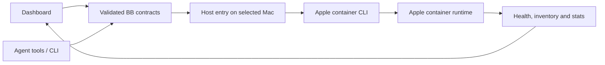

<div align="center">


# Apple Containers

### Your Mac’s containers, ready for your BB agents.

A container workspace inside BB, with live monitoring and a focused inspector.<br>
Create Linux containers, build images and run commands from the dashboard or your agents.


[Features](#features) · [Install](#install) · [CLI](#cli) · [Settings](#settings) · [Development](#development)


</div>

The screenshots show a disposable demonstration container in the real BB plugin. The machine name is anonymised. The dark capture uses browser-local theme tokens without changing BB’s saved appearance.

## The problem

You want a Linux workspace without losing track of what is running on your Mac. This plugin gives you a dashboard for Apple’s container runtime and lets BB agents use the same controls.

| You need                  | You get                                                                |
| ------------------------- | ---------------------------------------------------------------------- |
| Runtime visibility        | Health, inventory and live resource charts                             |
| A container workspace     | Searchable source list, inspector, logs and command console            |
| Agent access              | Six native tools, a CLI and a bundled skill                            |
| Correct machine targeting | Commands run on the thread’s environment host, with explicit overrides |

## Features

|                                                                                                                                                                                                  |                                                                                                                                      |
| ------------------------------------------------------------------------------------------------------------------------------------------------------------------------------------------------ | ------------------------------------------------------------------------------------------------------------------------------------ |
| **Live monitoring.** CPU, memory, network receive and disk read charts sampled every five seconds while the page is visible. Send/write rates appear alongside them.                             | **Container inspector.** Select a container to see configuration, networking, resource history, logs and a command console.          |
| **Create and control.** A creation sheet accepts commands, CPU/memory limits, ports, environment variables and an optional read-only folder mount. Start, stop and delete individual containers. | **Image library.** Pull an OCI image, build a Dockerfile on your Mac, or run a container directly from a local image.                |
| **Resource navigation.** Dedicated dashboard, containers, images, networks and volumes views. The sidebar and split view adapt to narrower panes.                                                | **Agent tools.** Agents can check health, create containers, execute guest commands, read logs and manage images on the correct Mac. |

<p align="center"> </p>

The interface draws on [Davit](https://davit.app), [Orchard](https://github.com/andrew-waters/orchard) and [ContainerUI](https://github.com/kylemclaren/container-ui). It is implemented for BB’s web extension surface; it does not embed those apps.

## Install

From this local checkout:

```sh
npm ci --include=dev
bb plugin build
bb plugin install . --yes
```

Open **Apple Containers** in BB’s navigation. New provider sessions receive the native tools and bundled skill.

**Requirements:** BB 0.46+, Plugin SDK 0.6.49+, an enrolled Apple silicon Mac with macOS 26+ and Apple’s `container` CLI. Runtime integration was verified with CLI **1.5.0**. Install Apple’s tooling using its [official instructions](https://github.com/apple/container). The plugin auto-detects Homebrew and standard installer paths.

## Where to find it

| Where                                               | What                                                                     |
| --------------------------------------------------- | ------------------------------------------------------------------------ |
| **Apple Containers → Dashboard**                    | Runtime health, inventories and recent resource history                  |
| **Containers**                                      | Source list, live inspector, logs, command console and raw configuration |
| **Images**                                          | Pull, build and run images                                               |
| **Volumes / Networks**                              | Read-only local inventory                                                |
| **Settings → Installed plugins → Apple Containers** | Machine default, executable and control settings                         |

## How it works



- **Machine-aware.** Native tools and CLI calls in a thread default to its environment host. Outside a thread, supply `--host`, configure a default, or have exactly one enrolled host.
- **Shared controls.** The dashboard, tools and CLI use the same command validation and ownership rules.
- **Real measurements.** CPU uses cumulative counter deltas and elapsed time, normalised to allocated virtual CPUs. Network and disk rates use byte-counter deltas. Charts retain up to 60 samples in memory while the page is mounted; the first CPU sample waits for a baseline.
- **Explicit scope.** The plugin lets agents execute work inside containers. Entire BB provider sessions continue to run on their selected BB machine.

## Container controls

- **Ownership protection.** Start, stop, delete and exec require `app.getbb.apple-containers.managed=true` by default. Reads include external containers. This is an accidental-change guard for a shared Mac user, not an isolation boundary between agents.
- **Explicit access.** Mounts default to read-only. Published ports bind to `127.0.0.1`. No host shell, implicit environment inheritance into guests, SSH forwarding, bulk prune or forced container deletion is exposed.
- **Predictable lifetime.** Disabling/reloading the plugin leaves containers running. No Apple software or kernel is installed automatically.
- **Bounded output.** Processes retain 256 KiB across stdout/stderr. Dashboard lists retain 500 records each; tool responses retain 48,000 characters. Clipping is labelled, and clipped JSON is rejected.
- **Cancellation.** Timeout/cancellation terminates and reaps the CLI. A guest command or runtime operation may continue; inspect state before retrying. Mutations are not automatically retried. Run, pull and build allow ten minutes; exec defaults to 60 seconds, configurable from 1–600.

## CLI

```sh
bb apple-containers hosts --json
bb apple-containers status --json
bb apple-containers run --name workspace alpine:3.23 -- sleep infinity
bb apple-containers exec workspace -- sh -lc 'uname -a; pwd'
bb apple-containers logs workspace --lines 100
bb apple-containers stop workspace
bb apple-containers delete workspace
```

<details>
<summary><b>All commands</b></summary>

| Command                                 | Purpose                                                     |
| --------------------------------------- | ----------------------------------------------------------- |
| `hosts`                                 | List BB machine IDs                                         |
| `status`                                | Runtime health and complete inventory snapshot              |
| `list`                                  | List running and stopped containers                         |
| `run <image> --name <name> -- [argv…]`  | Create a detached managed container                         |
| `exec <id> -- [argv…]`                  | Execute a command in a managed container                    |
| `logs <id> --lines 200`                 | Read the log tail                                           |
| `inspect <id>` / `stats <id>`           | Read configuration or one resource snapshot                 |
| `start <id>` / `stop <id>`              | Control one container                                       |
| `delete <id>`                           | Delete one stopped container                                |
| `pull <image>`                          | Pull an OCI image                                           |
| `build /absolute/context --tag app:dev` | Build from a Dockerfile                                     |
| `system start`                          | Start the service without automatically installing a kernel |

Operational commands accept `--host <id>` and `--json`. Run also accepts `--cpus`, `--memory` (MiB), `--env KEY=value`, `--port host:guest`, `--mount /source:/target[:ro|rw]` and `--workdir`. Exec accepts `--timeout` in seconds. Build accepts `--file /absolute/Dockerfile`. Use command-level `--help` for validated limits.

</details>

**Agent tools:** `apple_container_status`, `apple_container_run`, `apple_container_exec`, `apple_container_read`, `apple_container_manage`, `apple_container_image`. Optional `hostId` targets another enrolled Mac. The bundled [skill](skills/apple-containers/SKILL.md) documents schemas, CLI use, limits and operating rules.

The dashboard command fields support quoted arguments without shell expansion. For shell pipelines or scripts, explicitly enter `sh -lc 'your script'`. The console runs individual commands; it is not an interactive PTY.

## Settings

<details>
<summary><b>All settings</b></summary>

| Setting            | Default | Effect                                                                                   |
| ------------------ | ------- | ---------------------------------------------------------------------------------------- |
| `binaryPath`       | Empty   | Auto-detect the CLI on each Mac, or use an absolute executable path                      |
| `defaultHostId`    | Empty   | Default for CLI calls outside a thread when multiple machines exist                      |
| `allowExternal`    | `false` | Permit start/stop/delete/exec on containers created outside this plugin                  |
| `enableAgentTools` | `true`  | Select native tools for new sessions; false also rejects existing tool calls immediately |

Settings apply without reloading. Disabling native tools leaves the dashboard and CLI usable.

</details>

<details>
<summary><b>Turning it off</b></summary>

```sh
bb plugin disable apple-containers
bb plugin enable apple-containers
```

Containers retain their current state. Use explicit container commands to stop or delete them.

</details>

## Development

```sh
npm ci --include=dev
npm test
npm run typecheck
npm run format:check
bb plugin build
bb plugin install . --yes
bb plugin dev
```

```text
server.ts      settings, tools, CLI and host routing
host.ts        execution on the selected Mac
contract.ts    validated wire contracts
lib/           process execution, command policy and runtime parsing
ui/            dashboard components and runtime sampling
app.tsx        workspace navigation and layout
styles.css     scoped desktop and responsive styles
skills/        bundled agent instructions
tests/         command policy, lifecycle, routing, metrics and UI tests
docs/          design notes, verification and screenshots
```

Tests use real child processes for output limits/cancellation and the public BB SDK harness for routing, schema boundaries, native tools and rendered UI. Live verification covers a disposable container, read-only mounts, loopback ports and the installed BB dashboard. See [verification evidence](docs/VERIFICATION.md) and [design decisions](docs/DESIGN.md).

`PLUGIN_OVERVIEW.md` is the store listing. No remote repository or marketplace release has been created.

## Licence

[MIT](LICENSE)
