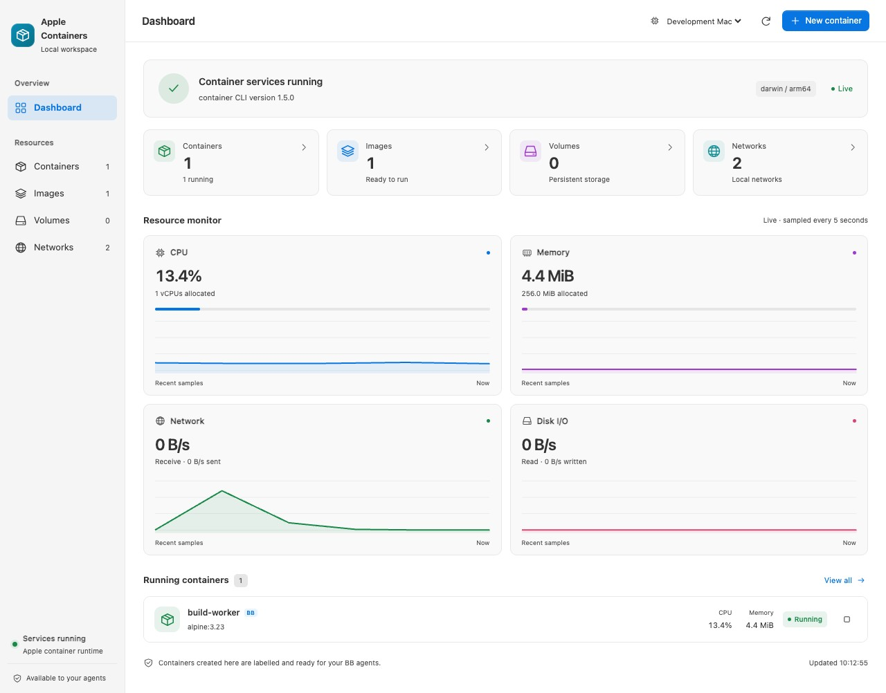
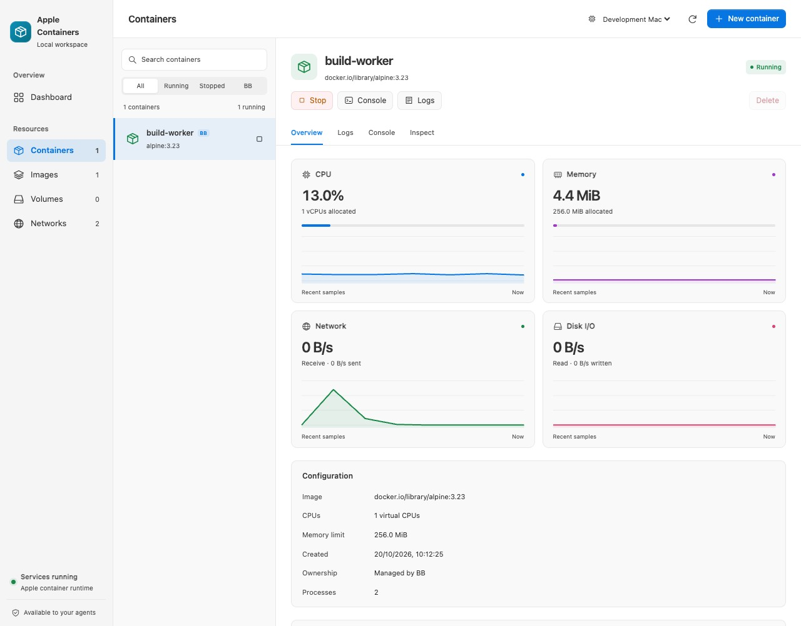
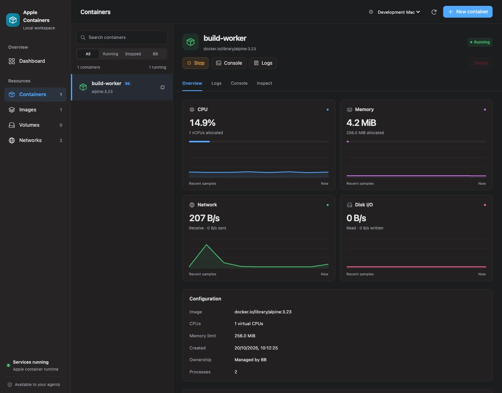
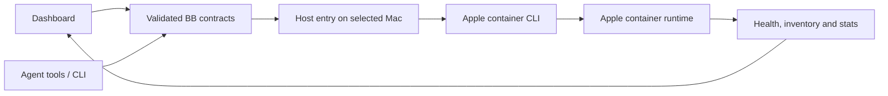

<div align="center">


# Apple Containers

### Your Mac’s containers, ready for your BB agents.

**Work in progress (WIP).** Features, configuration and behaviour are still evolving.

Manage your Mac’s Linux containers from BB, with live monitoring and a focused inspector.<br>
Give your project checkouts and worktrees their own app, database and development tools.


[Features](#features) · [Install](#install) · [How it works](#how-it-works) · [CLI](#cli) · [Settings](#settings) · [Development](#development)


</div>

> [!NOTE]
> These are real BB captures of a disposable demonstration workload, with fictional machine labels and observed metrics. They show an earlier WIP interface. The dark capture uses browser-local theme tokens without changing BB’s saved appearance.

## The problem

You want a Linux workspace without losing track of what is running on your Mac. This plugin gives you a dashboard for Apple’s container runtime and lets BB agents use the same controls.

| You need                  | You get                                                                |
| ------------------------- | ---------------------------------------------------------------------- |
| Runtime visibility        | Health, inventory and live resource charts                             |
| A container workspace     | Searchable source list, inspector, logs and command console            |
| Agent access              | Ten native tools, a CLI and a bundled skill                            |
| Correct machine targeting | Commands run on the thread’s environment host, with explicit overrides |
| Project environments      | One project setup, with separate containers and data for each worktree |

## Features

<table>
<tr>
<td width="50%" valign="top">

### 📊 Live monitoring

Check service health, browse resources and follow measured CPU, memory,
network and disk I/O. Charts sample every five seconds while the page is visible.

</td>
<td width="50%" valign="top">

### 📦 Container workspace

Create containers, choose CPU and memory limits, and configure ports and mounts.
Inspect configuration, read logs and run commands from a focused source list.

</td>
</tr>
<tr>
<td valign="top">

### 🖼️ Image library

Pull OCI images, build a Dockerfile on the selected Mac, or run a local image.
Browse networks and named volumes without bulk removal controls.

</td>
<td valign="top">

### 🌱 Project environments

Save an app and service setup once. Each checkout or worktree gets its own
containers, network, loopback ports and persistent volumes.

</td>
</tr>
<tr>
<td valign="top">

### 🧊 Thread status

See the current workspace’s container state in its thread header. Open service
images, ports and logs, or start and stop the stack from the badge.

</td>
<td valign="top">

### 🛠️ CLI and native tools

Use the same validated controls from the dashboard, CLI or your BB sessions.
Commands resolve the workspace’s Mac; Git and provider sessions stay on the host.

</td>
</tr>
</table>

<div align="center">
<table>
<tr>
<td align="center"><br><sub><b>Container inspector in light appearance</b></sub></td>
<td align="center"><br><sub><b>The same workspace in dark appearance</b></sub></td>
</tr>
</table>
</div>

The interface draws on [Davit](https://davit.app), [Orchard](https://github.com/andrew-waters/orchard) and [ContainerUI](https://github.com/kylemclaren/container-ui). It is implemented for BB’s web extension surface; it does not embed those apps.

## Install

Install the WIP source from GitHub:

```sh
bb plugin install git:https://github.com/MacHatter1/bb-plugin-apple-containers --yes
```

<details>
<summary><b>Install from a local clone</b></summary>

```sh
git clone https://github.com/MacHatter1/bb-plugin-apple-containers
cd bb-plugin-apple-containers
npm ci --include=dev
bb plugin build
bb plugin install "path:$PWD" --yes
```

</details>

Open **Apple Containers** in BB’s navigation. New provider sessions receive the native tools and bundled skill.

**Requirements:** BB 0.46+, Plugin SDK 0.6.49+, an enrolled Apple silicon Mac with macOS 26+ and Apple’s `container` CLI. Runtime integration was verified with CLI **1.5.0**. Install Apple’s tooling using its [official instructions](https://github.com/apple/container). The plugin auto-detects Homebrew and standard installer paths.

## Where to find it

| Where                                               | What                                                                                          |
| --------------------------------------------------- | --------------------------------------------------------------------------------------------- |
| **Apple Containers → Dashboard**                    | Runtime health, inventories and recent resource history                                       |
| **Containers**                                      | Source list, live inspector, logs, command console and raw configuration                      |
| **Images**                                          | Pull, build and run images                                                                    |
| **Apple Containers → Projects**                     | Save project setups and start, inspect, stop or replace workspace instances                   |
| **Volumes / Networks**                              | Read-only local inventory                                                                     |
| **Settings → Installed plugins → Apple Containers** | Machine default, executable and control settings                                              |
| **Thread header → Containers**                      | This checkout/worktree’s live container status, services, ports, logs and start/stop controls |

## How it works



- **Machine-aware.** Low-level tools and CLI calls in a thread default to its environment host. Outside a thread, supply `--host`, configure a default, or have exactly one enrolled host.
- **Shared controls.** The dashboard, tools and CLI use the same command validation and ownership rules.
- **Real measurements.** CPU uses cumulative counter deltas and elapsed time, normalised to allocated virtual CPUs. Network and disk rates use byte-counter deltas. Charts retain up to 60 samples in memory while the page is mounted; the first CPU sample waits for a baseline.
- **Explicit scope.** The plugin lets agents execute work inside containers. Entire BB provider sessions continue to run on their selected BB machine.
- **Worktree reuse.** Threads in the same checkout or worktree share its stack. Workspace commands resolve the thread’s environment; outside a thread, pass `--environment <id>`.

<details>
<summary><b>Project setups, worktrees and cleanup</b></summary>

Agents can configure the setup directly: `apple_workspace_setup({})` reads the
current project's profile, default development configuration and database
presets. Supplying `{profile: ...}` saves the full setup for that project. The
bundled skill walks agents through choosing tools, creating local environment
files, saving the profile, starting services and verifying them. Setup always
targets the invoking thread's project. Saving does not replace existing
containers; agents use `apple_workspace` and `apple_workspace_exec` to start and
work in the environment.

Open **Apple Containers → Projects**, choose a project, and enable
its container setup. Select a development image containing your tools, a start
command, the app's container ports, and an optional PostgreSQL or MySQL database.
Use **Custom services** for other images or multiple services.

Each BB environment—the project checkout or a worktree—gets its own container
stack, network, automatically allocated loopback ports, and named data volumes.
Threads sharing an environment reuse that stack. Identity follows the project
and BB environment IDs, rather than the branch name. Project settings apply
across Macs, while instances, mounted files, ports and data stay on their Mac.

Configured threads show a cube badge beside the workspace controls. It reports
Checking, Not started, Starting, Running, Stopping, Stopped, Needs attention, or Unavailable
from the workspace's observed container state. Click it for service images,
ports, persistent volume counts, logs, and Start / reuse or Stop controls.
Open dashboard selects that project, environment and Mac. On narrow screens the
badge collapses to an accessible cube icon. Status reads never start containers;
Running describes the containers, so check app readiness before opening its URL.
Threads without a project setup or existing workspace binding have no badge.
The badge reads the saved setup first, so it remains visible as Checking while
the Mac responds. Status inspection does not wait behind long container commands.

The agent and Git remain on the Mac. The app container mounts that workspace
read/write at `/workspace`; `apple_workspace_exec` runs development commands
there. With **Start when an agent begins work**, thread activity starts the
stack in the background. Project-specific instructions tell agents to await
`apple_workspace` before running app commands. Startup and explicit commands
are serialised per workspace, so concurrent threads reuse one instance.
If automatic startup fails, the agent tool or **Start / reuse** reports the error.
Worktree Git metadata can live outside the mounted folder, so tooling that
requires Git metadata must run on the Mac or receive version information from it.

The default development command is `sleep infinity`: it keeps tools available
without assuming how to start your application. For a Node development server,
for example, use `sh -lc 'npm ci && npm run dev -- --hostname 0.0.0.0'` with a
compatible image. The default Node profile uses a separate named volume for
`/workspace/node_modules`, keeping Linux dependencies off the Mac checkout.
Custom toolchains can use an image built from the existing **Images** view.

Credentials are read through `--env-file` from an ignored file **inside each
workspace**. The project setup stores only its relative filename, never the
file's contents. Symlinks escaping the workspace are rejected. For PostgreSQL,
the database file needs `POSTGRES_PASSWORD` and optionally `POSTGRES_DB`; for
MySQL, `MYSQL_ROOT_PASSWORD` and optionally `MYSQL_DATABASE`. Create these files
locally. If appropriate for your project, list the filenames in BB's tracked
`.worktreeinclude` to copy them to future worktrees. The plugin never copies
seed snapshots, automatically restores databases, or connects to a live database.

Database presets wait for a TCP readiness check before starting the app.
They initialize data in a subdirectory of the volume, avoiding the volume's
filesystem metadata at its root.
Services inject `<SERVICE_NAME>_HOST` and `<SERVICE_NAME>_PORT` into the app;
the `database` preset supplies `DATABASE_HOST` and `DATABASE_PORT`. These use
the guest network address and the first configured service port. Configure your
app to read them (or map them in its start command); no source or `.env` file is
rewritten. Each workspace has its own database volumes; later starts reuse
retained data. Initial data and migrations remain your project's setup commands.
Other than configured readiness commands, running containers do not prove the
app is ready.

**Stop** keeps containers and data. **Apply saved setup** replaces this
workspace's containers using the latest project settings, retaining named
volumes. Existing instances keep their original recipe until that explicit
action. Changes to service or volume names can create new volumes; old ones
remain intact. Database image upgrades still need an appropriate migration.
If a service's guest address changes after a restart, the plugin asks you to
apply the setup again instead of silently replacing the app container.
Resources created only inside a container's root filesystem are lost on
replacement, so put persistent data in named volumes or the workspace mount.

Archiving a thread does not directly stop a stack. After BB actually removes
its environment, the plugin stops that stack and retains its containers,
network and volumes; it retries missed/offline cleanup every minute. Disabling
or reloading the plugin leaves containers running. It never prunes database
data automatically. The dashboard's existing inspector provides logs and
individual container controls. Ports displayed here refer to the selected Mac.

```sh
bb apple-containers workspace up
bb apple-containers workspace status --json
bb apple-containers workspace stop
bb apple-containers workspace teardown --dry-run --json
bb apple-containers workspace teardown
# Explicitly delete persistent workspace data too:
bb apple-containers workspace teardown --remove-volumes
# Explicitly replace containers, keeping named data volumes:
bb apple-containers workspace recreate
```

These commands use the invoking thread's BB environment. Outside a thread,
pass `--environment <environment-id>`. The workspace commands resolve the
machine from that environment; they do not accept an unrelated host override.

Agents receive `apple_workspace_teardown` and instructions to call it after
finishing container work, unless the user or repository needs the runtime kept
running. Default teardown removes this environment's owned containers (including
writable root filesystems) and network. Named volumes and shared images remain;
the result lists retained volumes. `--remove-volumes` also deletes this
environment's persistent databases and caches, including older recipe volumes.
It requires explicit intent to delete that data. `--dry-run` previews resource
names without changes. Source files and other worktrees are left alone.

Teardown refuses while another thread in the same BB environment is active,
starting, stopping or pending, or while a workspace command is in progress. The
calling thread is excluded. This is a thread-state check; a new thread can start
after that check. A later `workspace up` reuses retained volume names. Cleanup
errors may leave a partial stack; inspect status and preview before retrying.

</details>

## Safe by default

- **Ownership protection.** Start, stop, delete and exec require `app.getbb.apple-containers.managed=true` by default. Reads include external containers. This is an accidental-change guard for a shared Mac user, not an isolation boundary between agents.
- **Explicit access.** Manual mounts default to read-only; project app containers mount their workspace read/write. Published ports bind to `127.0.0.1`. No host shell, implicit environment inheritance into guests, SSH forwarding, bulk prune or forced container deletion is exposed.
- **Predictable lifetime.** Disabling/reloading the plugin leaves containers running. No Apple software or kernel is installed automatically.
- **Bounded output.** Processes retain 256 KiB across stdout/stderr. Dashboard lists retain 500 records each; tool responses retain 48,000 characters. Clipping is labelled, and clipped JSON is rejected.
- **Cancellation.** Timeout/cancellation terminates and reaps the CLI. A guest command or runtime operation may continue; inspect state before retrying. Mutations are not automatically retried. Run, pull and build allow ten minutes; exec defaults to 60 seconds, configurable from 1–600.

## CLI

```sh
bb apple-containers hosts --json
bb apple-containers status --json
bb apple-containers run --name workspace alpine:3.23 -- sleep infinity
bb apple-containers exec workspace -- sh -lc 'uname -a; pwd'
bb apple-containers logs workspace --lines 100
bb apple-containers stop workspace
bb apple-containers delete workspace
```

<details>
<summary><b>All commands</b></summary>

| Command                                 | Purpose                                                       |
| --------------------------------------- | ------------------------------------------------------------- |
| `hosts`                                 | List BB machine IDs                                           |
| `status`                                | Runtime health and complete inventory snapshot                |
| `list`                                  | List running and stopped containers                           |
| `run <image> --name <name> -- [argv…]`  | Create a detached managed container                           |
| `exec <id> -- [argv…]`                  | Execute a command in a managed container                      |
| `logs <id> --lines 200`                 | Read the log tail                                             |
| `inspect <id>` / `stats <id>`           | Read configuration or one resource snapshot                   |
| `start <id>` / `stop <id>`              | Control one container                                         |
| `delete <id>`                           | Delete one stopped container                                  |
| `pull <image>`                          | Pull an OCI image                                             |
| `build /absolute/context --tag app:dev` | Build from a Dockerfile                                       |
| `system start`                          | Start the service without automatically installing a kernel   |
| `workspace up` / `workspace status`     | Start or inspect this checkout/worktree's project services    |
| `workspace stop`                        | Stop workspace containers and keep data                       |
| `workspace recreate`                    | Apply saved setup, replacing containers and keeping volumes   |
| `workspace teardown --dry-run --json`   | Preview removal of owned workspace containers and networks    |
| `workspace teardown`                    | Remove workspace containers and network; retain named volumes |
| `workspace teardown --remove-volumes`   | Also delete persistent workspace data when explicitly wanted  |

Low-level operational commands accept `--host <id>` and `--json`. Workspace commands accept `--environment <id>` and `--json`; they resolve the Mac from that BB environment. Run also accepts `--cpus`, `--memory` (MiB), `--env KEY=value`, `--port host:guest`, `--mount /source:/target[:ro|rw]` and `--workdir`. Exec accepts `--timeout` in seconds. Build accepts `--file /absolute/Dockerfile`. Use command-level `--help` for validated limits.

</details>

**Agent tools:** `apple_container_status`, `apple_container_run`, `apple_container_exec`, `apple_container_read`, `apple_container_manage`, `apple_container_image`, `apple_workspace_setup`, `apple_workspace`, `apple_workspace_exec`, `apple_workspace_teardown`. The six low-level tools accept optional `hostId`; workspace tools always use the invoking thread's project and environment. The bundled [skill](skills/apple-containers/SKILL.md) documents setup, cleanup, schemas, CLI use, limits and operating rules.

The dashboard command fields support quoted arguments without shell expansion. For shell pipelines or scripts, explicitly enter `sh -lc 'your script'`. The console runs individual commands; it is not an interactive PTY.

## Settings

Use `bb plugin config apple-containers` or **Settings → Installed plugins → Apple Containers**.

<details>
<summary><b>All settings</b></summary>

| Setting            | Default | Effect                                                                                   |
| ------------------ | ------- | ---------------------------------------------------------------------------------------- |
| `binaryPath`       | Empty   | Auto-detect the CLI on each Mac, or use an absolute executable path                      |
| `defaultHostId`    | Empty   | Default for CLI calls outside a thread when multiple machines exist                      |
| `allowExternal`    | `false` | Permit start/stop/delete/exec on containers created outside this plugin                  |
| `enableAgentTools` | `true`  | Select native tools for new sessions; false also rejects existing tool calls immediately |

Settings apply without reloading. Disabling native tools leaves the dashboard and CLI usable.

</details>

<details>
<summary><b>Turning it off</b></summary>

```sh
bb plugin disable apple-containers
bb plugin enable apple-containers
```

Containers retain their current state. Use explicit container commands to stop or delete them.

</details>

## Development

```sh
npm ci --include=dev
npm test
# Optional real-container integration test (creates and removes its own resources):
APPLE_CONTAINER_LIVE=1 npx vitest run tests/workspace-live.test.ts
npm run typecheck
npm run format:check
bb plugin build
bb plugin install "path:$PWD" --yes
bb plugin dev
```

```text
server.ts      settings, tools, CLI and host routing
host.ts        execution on the selected Mac
contract.ts    validated wire contracts
lib/           process execution, command policy and runtime parsing
ui/            dashboard components and runtime sampling
app.tsx        workspace navigation and layout
styles.css     scoped desktop and responsive styles
skills/        bundled agent instructions
tests/         command policy, lifecycle, routing, metrics and UI tests
docs/          design notes, verification and screenshots
```

Tests use real child processes for output limits/cancellation and the public BB SDK harness for routing, schema boundaries, native tools and rendered UI. Live verification covers a disposable container, read-only mounts, loopback ports and the installed BB dashboard. See [verification evidence](docs/VERIFICATION.md) and [design decisions](docs/DESIGN.md).

`PLUGIN_OVERVIEW.md` is the draft store listing. Keep its WIP status and claims in step with this README, the bundled skill and `bb.description` in `package.json`. The public GitHub repository contains the WIP source; no marketplace release has been published.

## Licence

[MIT](LICENSE)
